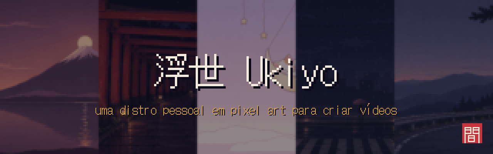
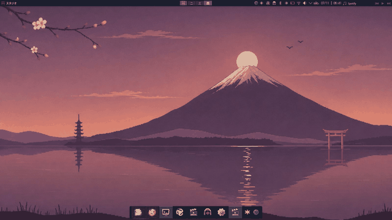
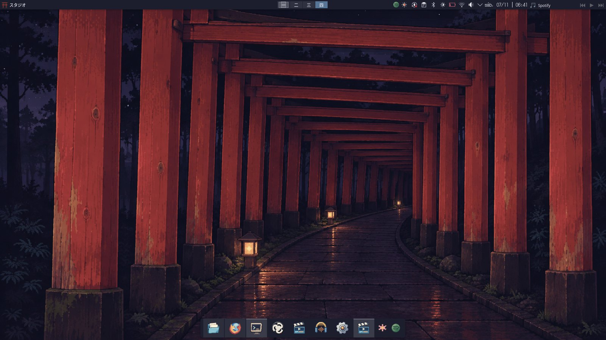
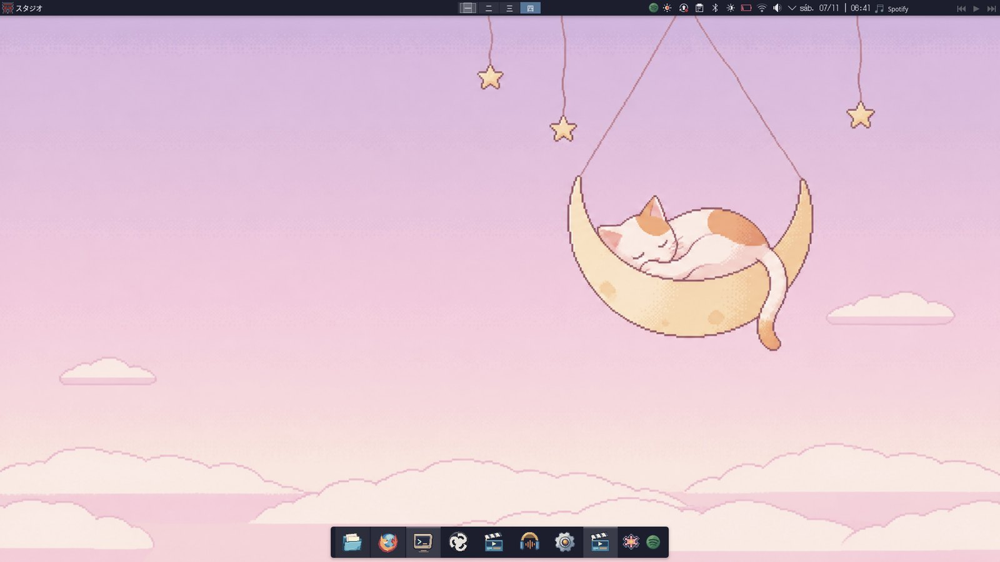
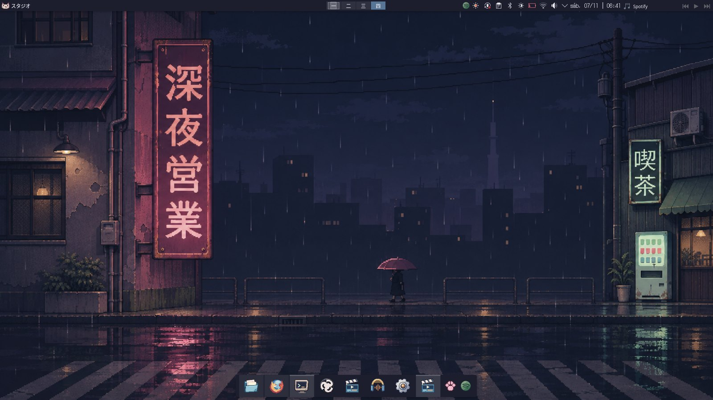
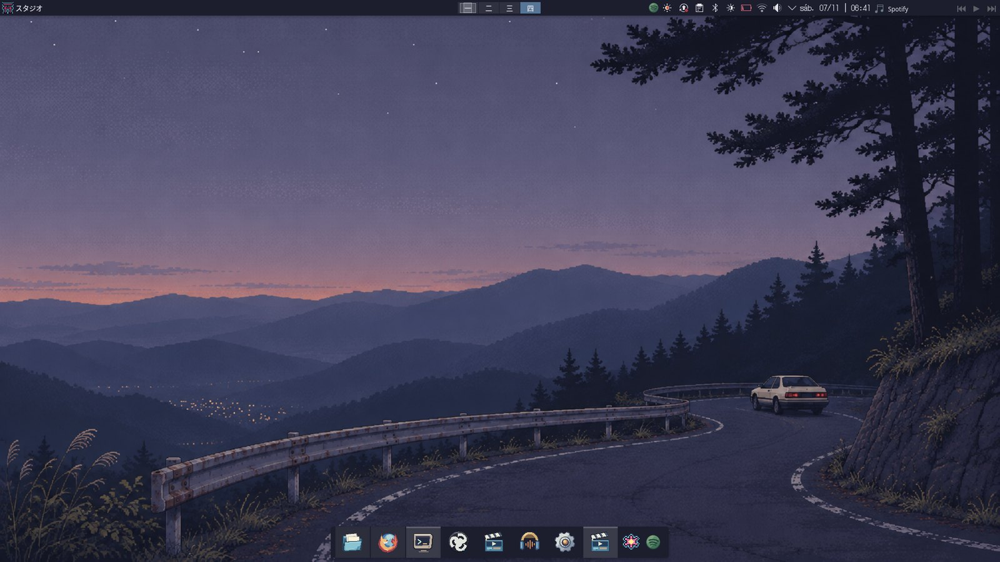
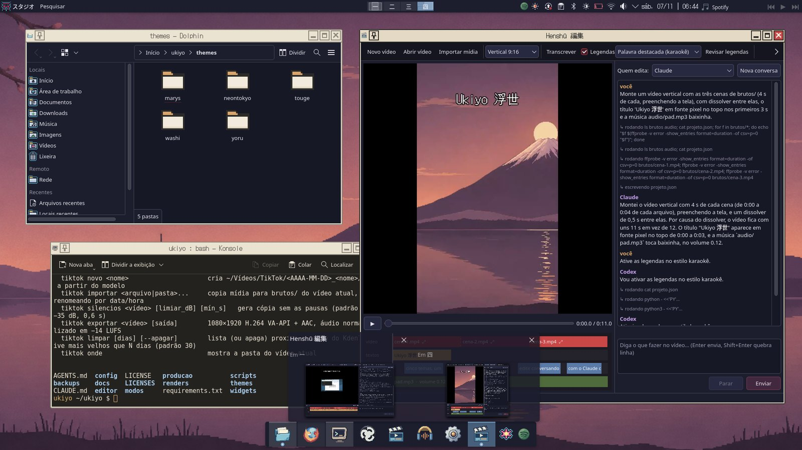
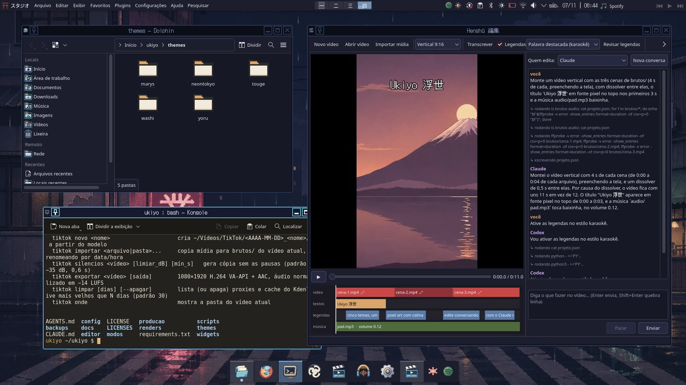
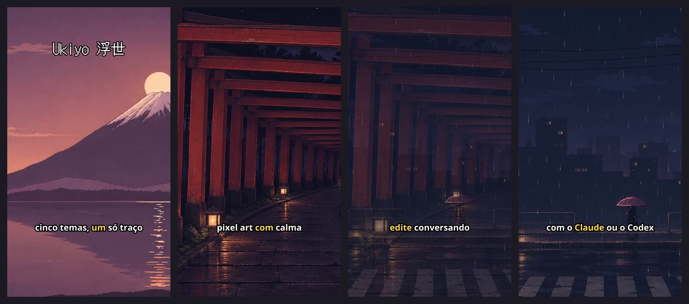

<p align="center">
  
</p>

<p align="center">
  <b>Debian 13 · KDE Plasma 6 (Wayland) · pixel art japonesa · produção de vídeo na GPU · editor com IA</b><br>
  <sub>Licença: código GPL-3.0-or-later · arte CC BY-SA 4.0 · <a href="#english">English summary</a></sub>
</p>

---

**Ukiyo (浮世, "mundo flutuante")** é a minha distro pessoal: um Debian com KDE Plasma inteiramente
redesenhado em pixel art japonesa e montado como estúdio para criar vídeos (TikTok, Reels, Shorts e YouTube).
O nome vem do ukiyo-e, a xilogravura de cenas passageiras do cotidiano, que é a referência dos degradês, da
composição e do silêncio dos papéis de parede.

Não é uma ISO. É um conjunto de **temas, ferramentas e fluxos reproduzíveis** que transformam um Debian + Plasma
comum, com scripts que **fazem backup antes de mudar qualquer coisa e sabem desfazer o que fizeram**.

<p align="center"></p>

## ✦ Cinco temas, um só traço

Cada tema troca papel de parede, ícones, decoração das janelas e tela de bloqueio em menos de um segundo, por um
widget na barra ou por `modos/modo-<tema>.sh`. As cores dos aplicativos ficam fixas: assim o KDE não trava ao trocar.

| | |
|---|---|
|  **Washi 和紙** — claro. Fuji de diamante: o sol pousado no cume, o reflexo partido no lago. |  **Yoru 夜** — escuro. Um túnel de mil torii que faz a curva rumo a uma luz escondida. |
|  **Mary's** — kawaii. A gatinha dorme numa lua crescente pendurada como móbile de berço. |  **Neon Tokyo** — cyberpunk. Um único letreiro, 深夜営業, acendendo a rua molhada. |
|  **Touge 峠** — passo de montanha. A estrada ao anoitecer, entre a serra e as luzes do vale. | **Detalhes em comum**<br>· ícones pixel próprios (com recurso ao Breeze)<br>· títulos de janela em DotGothic16<br>· decoração Aurorae desenhada por código<br>· tela de bloqueio e login combinando<br>· áreas de trabalho 一 二 三 四 |

A filosofia visual da série, **Ma Pixel 間** (o intervalo cheio de sentido), está em
[`docs/visual/filosofia-papeis-de-parede.md`](docs/visual/filosofia-papeis-de-parede.md).

<p align="center"></p>

## ✦ Henshū 編集 — edite vídeos conversando

Um editor próprio (Qt/PySide6) com **prévia ao vivo, linha do tempo e um chat em que você escolhe quem edita:
o Claude ou o Codex**. Você pede em português ("corta os 3 primeiros segundos", "coloca um dissolver",
"legenda no estilo karaokê") e assiste à edição acontecendo: o agente altera o projeto, e o Henshū refaz a prévia
na GPU em cerca de 2 segundos.

<p align="center"></p>

- **Formatos:** vertical 9:16 (1080×1920) e horizontal 16:9 (1920×1080).
- **Edição:** cortes, velocidade (0,25× a 4×, sem mudar o tom da voz), **reenquadrar** horizontal↔vertical
  escolhendo o ponto de foco, transições fade e dissolver, textos (inclusive em fonte pixel) e música de fundo.
- **Transcrição local** com [faster-whisper](https://github.com/SYSTRAN/faster-whisper): sem internet e sem custo.
  Em um notebook de 15 W, 22 s de fala levaram 5 s para transcrever.
- **Legendas** em três estilos (frases curtas, karaokê com a palavra falada em destaque e pixel), **revisáveis**
  numa tabela, queimadas no vídeo ou exportadas como `.srt`.
- **Capítulos** do YouTube (o agente cria pelos assuntos falados), embutidos no MP4 e em texto para a descrição.
- **Exportação** com áudio normalizado em −14 LUFS e vídeo codificado na GPU (VA-API).
- **Segurança:** cada agente só mexe na pasta do vídeo aberto e nunca apaga os brutos; o Codex roda isolado e sem rede.

<p align="center"></p>
<p align="center"><sub>Vídeo montado pelo Claude e pelo Codex no chat do Henshū (cenas animadas a partir dos papéis de parede; legendas de demonstração).</sub></p>

## ✦ Estúdio na GPU

- **`tiktok`**: uma esteira de pós-produção no terminal. `novo` cria a pasta do vídeo com modelo de roteiro,
  `importar` copia e renomeia os brutos, `silencios` corta as pausas, `exportar` gera o arquivo pronto com
  −14 LUFS e `limpar` remove os temporários.
- **Kdenlive** com proxies gerados na GPU e projeto vertical por padrão; **OBS** com perfil e cenas verticais em VA-API.
- **Regra da casa:** vídeo sempre codificado na GPU Intel (VA-API), nunca em x264 na CPU de 15 W.

## ✦ Widgets da barra

- **Tela:** brilho, **saturação real da tela** (perfis ICC gerados por código) e botões de troca de tema.
- **Spotify:** capa, faixa, controles e um volume só do Spotify.

## ✦ Feito à mão, por código

Quase tudo é **gerado por scripts determinísticos**: papéis de parede em pixel art (Python + Pillow/NumPy,
dithering Bayer, ampliação ×4 sem suavização), ícones, cursor, decoração Aurorae, esquemas de cores, perfis ICC
e o tema de login. As versões atuais dos papéis de parede são **refinos feitos com geração de imagem por IA** a
partir dessas artes; os prompts estão em [`docs/visual/refino-2026-11-07/prompts.md`](docs/visual/refino-2026-11-07/prompts.md),
e os originais em pixel continuam no repositório.

O projeto foi construído em parceria com agentes de IA (Claude Code e Codex), que seguem um arquivo único de
regras, o [`AGENTS.md`](AGENTS.md). O diário completo de cada mudança, com backup e como desfazer, está em
[`docs/mudancas.md`](docs/mudancas.md).

## ✦ Instalação

Testado em **Debian 13 (trixie) + KDE Plasma 6.3 em Wayland**, com GPU Intel (driver VA-API iHD). Cada etapa é
independente e reversível; o passo a passo completo está em **[`docs/instalacao.md`](docs/instalacao.md)**.

```bash
git clone https://github.com/Davimachados/ukiyo.git ~/ukiyo && cd ~/ukiyo
scripts/preparar-ambiente.sh          # ambiente Python do projeto (.venv)
modos/instalar-temas.sh               # pré-carrega os cinco temas
scripts/instalar-comandos.sh          # tiktok, henshu e o atalho do Henshū no menu
```

## ✦ Estrutura

| Pasta | O que tem |
|---|---|
| `themes/` | os cinco temas: geradores (`tools/`), ícones, decorações, esquemas, papéis de parede e prévias |
| `modos/` | troca rápida de tema e o registro único `temas.conf` (um tema novo é uma linha) |
| `editor/` | Henshū 編集: projeto, renderizador FFmpeg/VA-API, transcrição, legendas, ponte com os agentes e janela |
| `producao/` | a esteira `tiktok` |
| `widgets/` | widget do Spotify para o Plasma |
| `scripts/` | base de pixel art, ambiente Python, comandos, OBS e utilitários de GPU |
| `docs/` | instalação, plano, diário de mudanças, direção de arte e imagens |

## ✦ Privacidade e segurança

- Nenhuma senha, token ou chave no repositório. Os scripts **nunca** rodam `sudo` sozinhos: quando é preciso,
  eles mostram o comando para você rodar.
- Toda mudança de configuração começa com backup em `backups/` (fora do git) e tem um script ou uma instrução para desfazer.
- Capturas de tela pessoais, retratos de configuração e saídas de vídeo ficam fora do git (`.gitignore`).
- Veja [`SECURITY.md`](SECURITY.md).

## ✦ Licenças e créditos

- **Código:** [GPL-3.0-or-later](LICENSE).
- **Arte** (papéis de parede, ícones, decorações, cursor, banner): [CC BY-SA 4.0](LICENSES/CC-BY-SA-4.0.txt).
- **Tema de login** (`themes/washi/sddm/`): derivado do Breeze do KDE, sob [LGPL-2.0-or-later](LICENSES/LGPL-2.0-or-later.txt),
  com os créditos originais preservados nos arquivos.
- **Fontes** (não incluídas; vêm dos pacotes Debian): [DotGothic16](https://fonts.google.com/specimen/DotGothic16) (OFL) e Noto (OFL).
- **Agradecimentos:** KDE Plasma e Breeze, FFmpeg, faster-whisper, Qt/PySide6 e Debian.

---

<a id="english"></a>
### English summary

**Ukiyo (浮世, "floating world")** is a personal Debian 13 + KDE Plasma 6 setup redesigned in Japanese pixel art and
tuned as a video studio. It ships five switchable themes (wallpapers, icons, window decorations and lock screen,
all generated by code), a GPU-only (VA-API) post-production pipeline, and **Henshū 編集**, a Qt video editor with a
live preview and a chat panel in which **Claude or Codex edit the video for you**. It supports local transcription
with faster-whisper, karaoke-style subtitles, reframing, transitions, SRT export and YouTube chapters.
Every script backs up before changing anything and can undo its changes. Code is GPL-3.0-or-later; artwork is CC BY-SA 4.0.
